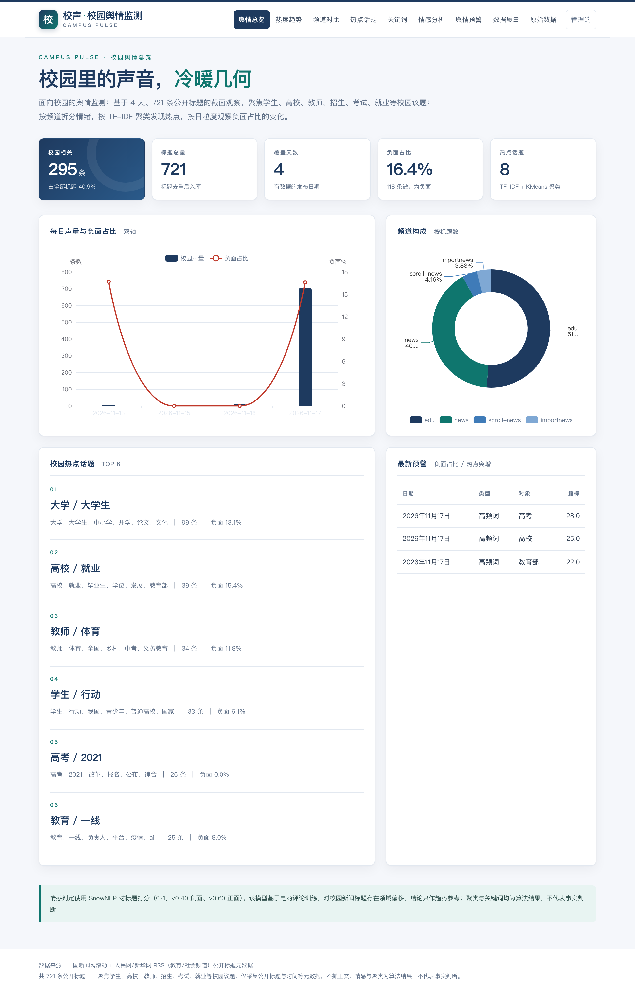
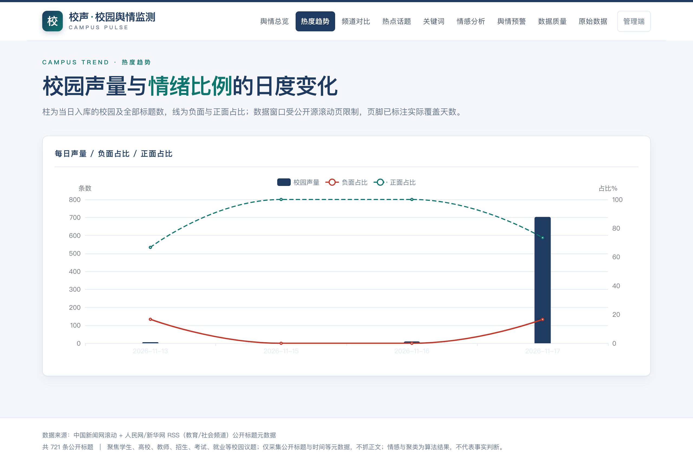
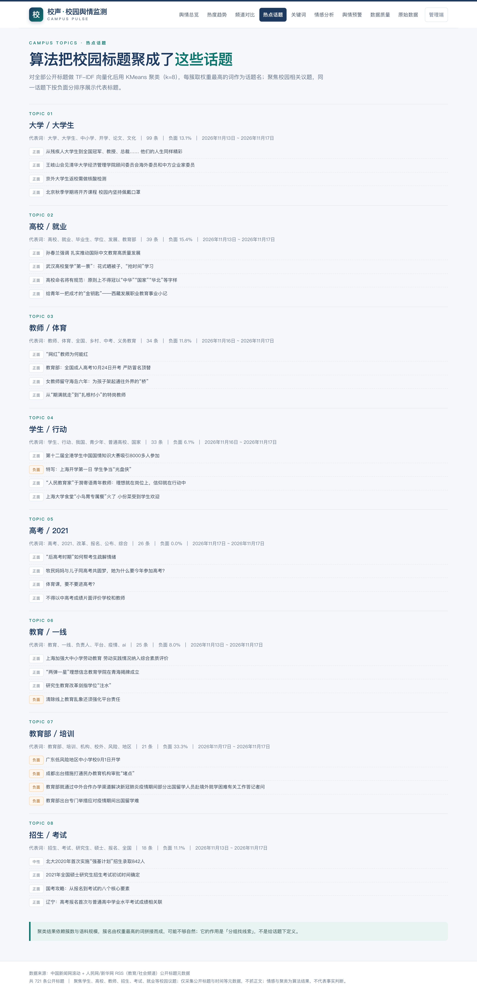
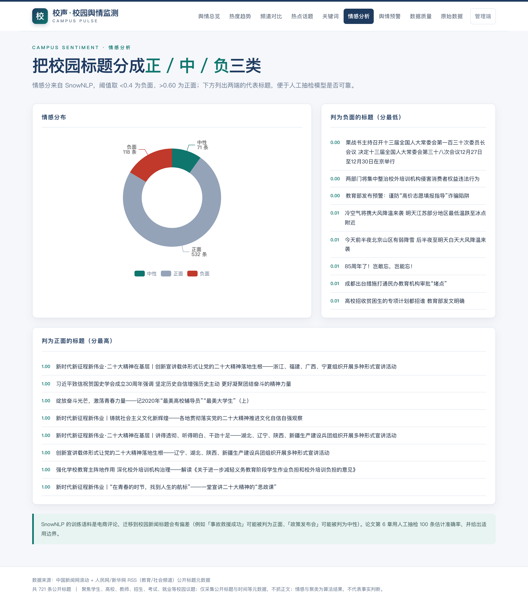
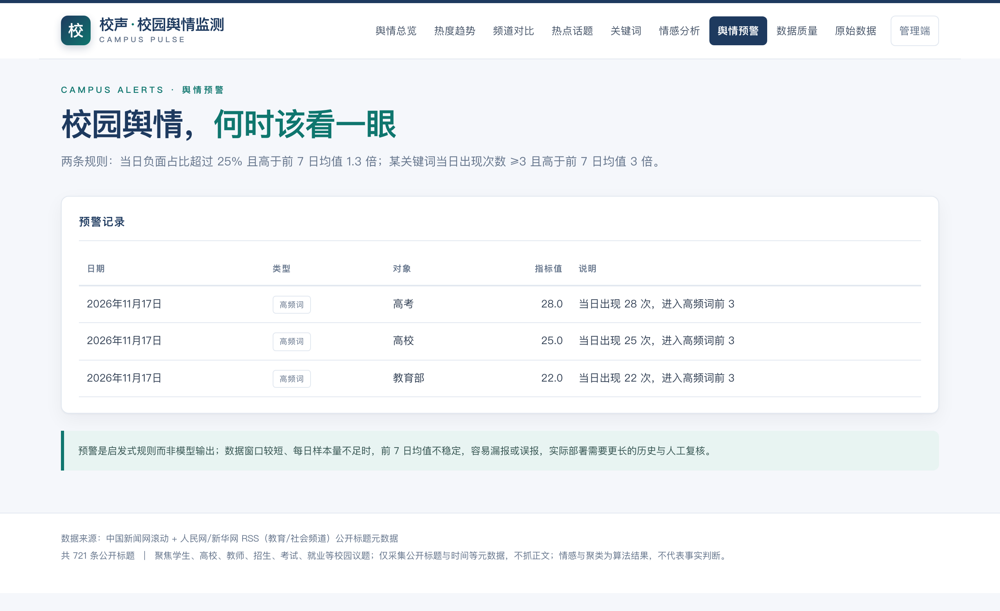
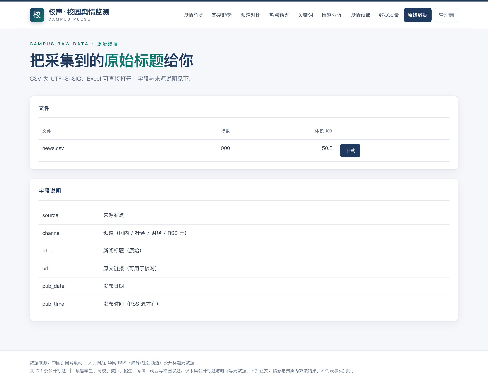

# 042 基于 Django 的校园舆情监测分析系统-设计展示

> **代码有偿获取 可接受定制 微信联系方式: csbysj2020 或 ACE2487，备注(BS)**

> **完整源码与全套文档 · 在线自助获取 >>> [https://mbd.pub/o/bread/YZaWl5xtZg==](https://mbd.pub/o/bread/YZaWl5xtZg==)**

> **成品页（功能介绍 / 更多选题）>>> [https://bishe.suilang.net/products/campus-opinion](https://bishe.suilang.net/products/campus-opinion)**

> 

> 

## 视频

> **点击查看 >>> [https://www.bilibili.com/video/BV1j3sz6vED8/](https://www.bilibili.com/video/BV1j3sz6vED8/)**

## 项目简介

面向校园话题的舆情监测：真实采集人民网、新华网、中新网公开 RSS 与滚动页标题 721 条，用校园关键词命中 295 条（40.9%）。对校园子集做 SnowNLP 情感判定、jieba TF-IDF + KMeans 话题聚类与绝对阈值预警，发现招生考试、高校就业、教育培训等热点话题。全网新闻作背景对比，情感领域偏移与短窗口基线如实写进论文。

面向高校的舆情监测既需要覆盖公开新闻的广度，也需要聚焦校园议题的深度。

本项目设计并实现了一套基于Django 的校园舆情监测分析系统：真实采集人民网 RSS（教育/社会频道）、新华网 RSS 与中国新闻网滚动新闻的公开标题与发布时间，清洗后得到 721 条有效标题，其中 295 条命中校园关键词（40.9%），覆盖 2026-11-13 至 2026-11-17 共 4 天。

系统在校园子集上完成SnowNLP 情感判定（532 正面 / 118 负面 / 71 中性，负面占比 16.37%）、jieba TF-IDF 关键词抽取、TF-IDF + KMeans 话题聚类（8 个话题）、绝对阈值预警（3 条），全网新闻作为背景对比保留，并以 9 个页面呈现。

本仓库为**设计展示**：包含项目说明、技术架构、实验结果与运行截图；完整源码、任务书、开题报告、毕业论文与使用说明可通过上方链接自助获取，成品页可查看更多选题，也可联系微信咨询定制。

## 功能特性

1. 真实采集：人民网/新华网/中新网公开 RSS + 中新网滚动页，721 条标题去重入库，不抓正文、低频请求

2. 校园维度：内置校园关键词表（学生/高校/教师/招生/考试/就业等），295 条命中（40.9%）

3. 话题聚类/关键词/预警聚焦校园子集，全网新闻保留作背景对比

4. 情感分析：SnowNLP 0–1 打分，<0.40 负面 / >0.60 正面，论文如实讨论领域偏移与抽检边界

5. 热点聚类：jieba 分词 + TF-IDF + KMeans 聚 8 个话题，代表词命名（招生/考试、高校/就业等）

6. 舆情预警：负面占比≥25% 与当日高频词前3且≥5次双规则，短窗口避免移动基线失真

7. 数据质量页：来源分布、去重、日期覆盖（2026-11-13~2026-11-17）、情感分布透明展示

8. 数字单一来源：页面与论文都读 data/stats.json，重跑三步命令即可同步

## 技术架构

| 项目 | 说明 |
| --- | --- |
| 编程语言 | Python 3.8 及以上 |
| Web 框架 | Django 4.2（默认 SQLite，免装数据库） |
| 情感分析 | SnowNLP（带领域偏移说明） |
| 文本处理 | jieba 分词 + TF-IDF + KMeans |
| 前端 | Django 模板 + ECharts |
| 样本规模 | 721 条新闻 / 295 条校园相关 / 4 天 |
| 运行端口 | http://127.0.0.1:8085 |
| 演示账号 | admin / admin123456 |

## 目录结构

以下为完整交付版的结构（本仓库仅作设计展示）：

```
campus-opinion/
├── campus/
│   ├── management/
│   │   ├── commands/
│   │   └── __init__.py
│   ├── migrations/
│   │   ├── 0001_initial.py
│   │   └── __init__.py
│   ├── __init__.py
│   ├── admin.py
│   ├── apps.py
│   ├── models.py
│   ├── urls.py
│   └── views.py
├── campusscope/
│   ├── __init__.py
│   ├── settings.py
│   ├── urls.py
│   └── wsgi.py
├── crawler/
│   └── fetch_news.py
├── data/
│   ├── analysis/
│   │   └── findings.json
│   ├── raw/
│   │   └── news.csv
│   └── stats.json
├── scripts/
│   └── export_stats.py
├── static/
│   ├── css/
│   │   └── style.css
│   ├── vendor/
│   │   └── echarts.min.js
│   └── favicon.svg
├── templates/
│   ├── alerts.html
│   ├── base.html
│   ├── channels.html
│   ├── dashboard.html
│   ├── keywords.html
│   ├── quality.html
│   ├── raw.html
│   └── …
└── …
```

## 数据与实验结论

- 校园相关并非人工真值，而是由 `CAMPUS_KEYWORDS` 字面命中判定，存在漏召与误召；情感分由基于电商评论语料训练的 SnowNLP给出，对新闻标题存在领域偏移；无监督聚类只能提供「找线索」的分组，不能当作事实分类；有效窗口只有4 天，因此预警放弃「前 7 日移动基线」而改用绝对阈值。
- 真实采集：人民网/新华网/中新网公开 RSS + 中新网滚动页，721 条标题去重入库，不抓正文、低频请求
- 校园维度：内置校园关键词表（学生/高校/教师/招生/考试/就业等），295 条命中（40.9%）
- 情感分析：SnowNLP 0–1 打分，<0.40 负面 / >0.60 正面，论文如实讨论领域偏移与抽检边界

## 交付内容

1. 完整源码（采集器 + Django 工程 + 情感/聚类/预警分析模块 + scripts）
2. 真实采集的新闻数据（data/raw/news.csv）与分析结果（findings.json）
3. 一键启动脚本（macOS / Windows）
4. 毕业设计任务书（Word）、开题报告（Word）
5. 毕业论文（Word，七章制，含架构图与首页截图）
6. 系统使用与二次开发说明（Word + md，12 节）
7. 6 张界面截图、论文配图、封面、演示视频

## 常见问题

**数据是爬的吗？能更新吗？**

是。crawler/fetch_news.py 从人民网/新华网/中新网公开 RSS 与滚动页抓标题元数据，不抓正文、不登录、低频请求。重跑 `python3 crawler/fetch_news.py` → `python3 manage.py import_news` → `python3 scripts/export_stats.py` 即可更新。

**校园相关是怎么判定的？**

标题命中 settings.CAMPUS_KEYWORDS（学生/高校/教师/招生/考试/就业等关键词）即标记为校园相关，话题聚类、关键词统计与预警都聚焦这批数据；可以自行增删关键词。

**情感分析准吗？**

SnowNLP 基于电商评论语料，存在领域偏移。论文第 6 章用人工抽检估计准确率并讨论边界，不把算法结果当事实判断。

**预警规则是什么？**

负面占比≥25% 记一条，当日高频词前3且≥5次记一条。因公开源只有数日窗口，用绝对阈值而非 7 日移动均值，避免基线失真。

**能换 MySQL 吗？**

能。设 DB_ENGINE=mysql 及 DB_NAME/DB_USER/DB_PASSWORD 后 migrate 即可，默认 SQLite 免安装。

**怎么加校园关键词？**

编辑 campusscope/settings.py 的 CAMPUS_KEYWORDS 列表，重跑 import_news 即可重新标注。

## 截图







